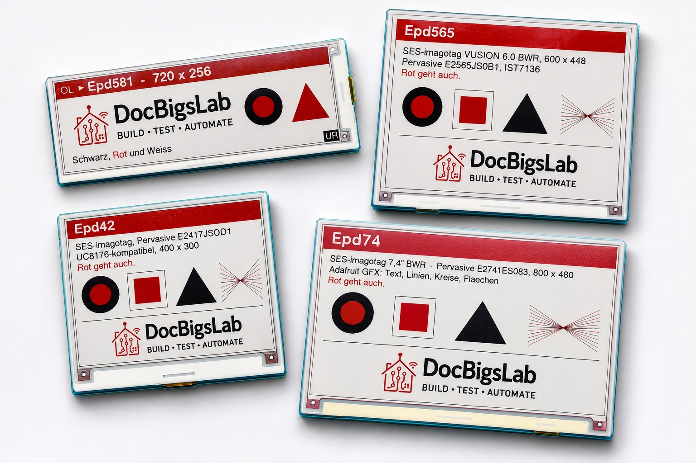
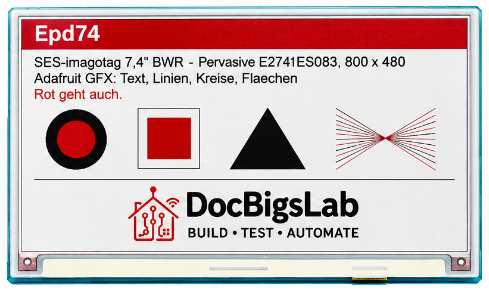
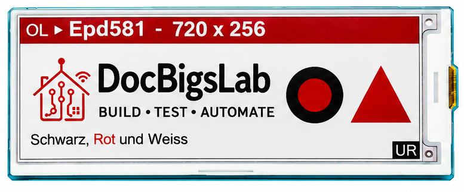
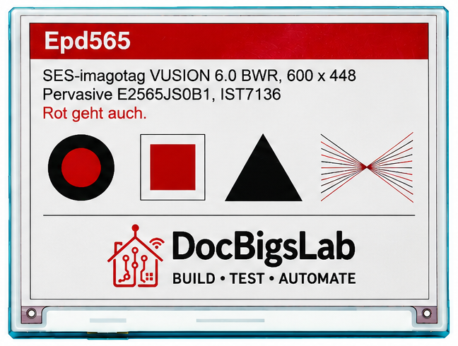
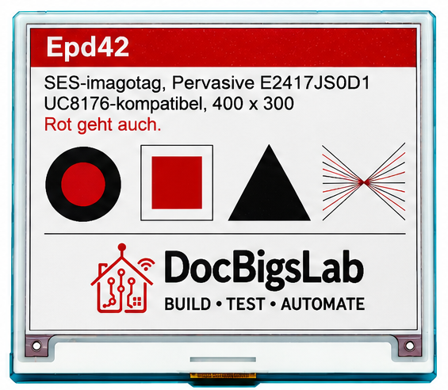

<p align="center">
  <a href="https://docbigs-lab.de">
    
  </a>
</p>
<p align="center">
  <a href="https://docbigs-lab.de">https://docbigs-lab.de</a>
</p>


# ses-imagotag-bwr-epaper

Bibliothek `SesEpaper` für E-Paper-Panels in Schwarz/Weiß/Rot aus SES-imagotag-Preisschildern, für ESP32 und Adafruit GFX.

*Library for black/white/red e-paper panels from SES-imagotag shelf labels (Pervasive Displays E2741ES083 7.4", E2581JS061 5.81", E2565JS0B1 5.65" and E2417JS0D1 4.2") on ESP32, based on Adafruit GFX. Documentation is in German.*

Vorgestellt im [Adafruit-Blog](https://blog.adafruit.com/2026/11/20/esp32-drivers-for-tri-color-e-paper-panels-from-ses-imagotag-shelf-labels/) am 20.11.2026.



| 7,4" mit `Epd74` | 5,81" mit `Epd581` | 5,65" mit `Epd565` | 4,2" mit `Epd42` |
|---|---|---|---|
|  |  |  |  |

## Welches Panel habe ich?

| | 7,4" | 5,81" | 5,65" | 4,2" |
|---|---|---|---|---|
| Preisschild | SES-imagotag | SES-imagotag VUSION 5.9 BWR, Modell `EDG3-0590-A` | SES-imagotag VUSION 6.0 BWR, Modell `EDG3-0600-A` | SES-imagotag |
| Etikett auf dem Panel | `VE2741ES083...` | `SE2581JS061...` | `SE2565JS0B1...` | `SE2417JS0D1...` |
| Pervasive-Typ | E2741ES083 | E2581JS061 | E2565JS0B1 | E2417JS0D1 |
| Flexkabel | 24 Pin, `A1360059-00` | 24 Pin, `A1360117-00` | 24 Pin, `A1360116-00` | 24 Pin, `A1360093-00` |
| Auflösung | 800 × 480 | 720 × 256 | 600 × 448 | 400 × 300 |
| Controller, Antwort auf `0x70` | IST7x32, `71 32 5A` | Generation 06, `16 87 05` | IST7136, `71 36 5A` | UC8176-kompatibel, `00 07 FF` |
| Klasse | `Epd74` | `Epd581` | `Epd565` | `Epd42` (oder GxEPD2 `GxEPD2_420c`) |
| Refresh bei 25 °C | ca. 28 s | ca. 52 s | ca. 31 s | ca. 23 s (bei 5 °C ca. 55 s) |
| Details | [doc/panel-7.4-zoll.md](doc/panel-7.4-zoll.md) | [doc/panel-5.81-zoll.md](doc/panel-5.81-zoll.md) | [doc/panel-5.65-zoll.md](doc/panel-5.65-zoll.md) | [doc/panel-4.2-zoll.md](doc/panel-4.2-zoll.md) |

Das 7,4"-, 5,81"- und 5,65"-Panel verstehen **keinen** der üblichen Befehlssätze (UC81xx, SSD16xx). GxEPD2 und ähnliche Bibliotheken funktionieren damit nicht. Das 4,2"-Panel läuft zwar auch mit GxEPD2, dort lässt sich aber die Temperatur nicht setzen. Davon hängt ab, ob Schwarz satt wird (siehe [Temperatur und Schwarz](doc/panel-4.2-zoll.md#temperatur-und-schwarz)).

Bei einem unbekannten Panel hilft die [Diagnosefirmware](extras/diagnose/): Taste `i` liest die Chip-ID und nennt das Panel, `o` gibt das OTP aus. Beide lesen nur. Sie liegt für beide Boards auch fertig als `.bin` bei und lässt sich ohne Entwicklungsumgebung im Browser flashen. Den ganzen Ablauf vom Flashen bis zur Beurteilung des Bildes beschreibt [doc/diagnose.md](doc/diagnose.md).

## Boards

| | Waveshare e-Paper ESP32 Driver Board | Seengreat ESP32-C6 E-Paper Driver Board |
|---|---|---|
| Schalter | 1 = **B**, 2 = **ON** | S1 = **ON**, S2 = **ON** |
| Pins im Code | `EpdPins` (Standard) | `epdPinsSeengreatC6()` |
| PlatformIO-Umgebung | `esp32dev` | `esp32c6` |

Pins, Schalter und Flexkabel-Belegung: [doc/boards.md](doc/boards.md). Andere Boards gehen über eigene `EpdPins`.

### Getestet

| Panel | Waveshare ESP32 | Seengreat ESP32-C6 |
|---|---|---|
| 7,4" `Epd74` | ✓ Bibliothek und Demo | ✓ Bibliothek und Demo |
| 5,81" `Epd581` | ✓ Bibliothek und Demo | ✓ Bibliothek und Demo |
| 5,65" `Epd565` | ✓ Bibliothek und Demo | ✓ Bibliothek und Demo |
| 4,2" `Epd42` | ✓ Bibliothek und Demo | ✓ Bibliothek und Demo; GxEPD2 ✓ im Wetter-Kalender |

## Einbinden

**PlatformIO:**

```ini
lib_deps =
    docbigs-lab/SesEpaper@^2.1.1
```

Die Bibliothek steht in der [PlatformIO-Registry](https://registry.platformio.org/libraries/docbigs-lab/SesEpaper). Alternativ direkt von GitHub: `https://github.com/DocBigs-Lab/ses-imagotag-bwr-epaper#v2.1.1`

**Arduino IDE:** Unter *Werkzeuge → Bibliotheken verwalten* nach `SesEpaper` suchen und installieren. Adafruit GFX wird dabei mit angeboten. Die Demos stehen danach unter *Datei → Beispiele → SesEpaper*. Als Board ein ESP32 bzw. ESP32-C6 wählen (Boardpaket esp32 von Espressif).

### 7,4"

```cpp
#include <Epd74.h>

Epd74 epd;                          // Waveshare; Seengreat: Epd74 epd(epdPinsSeengreatC6());

void setup() {
    epd.begin();
    epd.fillScreen(EPD_WHITE);
    epd.setTextColor(EPD_RED);
    epd.setCursor(20, 40);
    epd.print("Hallo");
    epd.display();                  // Refresh dauert ca. 28 s
}

void loop() {}
```

### 5,65"

```cpp
#include <Epd565.h>

Epd565 epd(epdPinsSeengreatC6());   // Waveshare: Epd565 epd;

void setup() {
    if (!epd.begin()) return;       // false: kein Speicher oder OTP nicht lesbar
    epd.fillScreen(EPD_WHITE);
    epd.setTextColor(EPD_RED);
    epd.setCursor(20, 40);
    epd.print("Hallo");
    epd.display();                  // Refresh dauert ca. 31 s
}

void loop() {}
```

`Epd565` liest beim Start das OTP des Panels und nimmt alle Parameter von dort: Bildfenster, Timing und die Tabelle für den Hochlauf der Hochspannung.

### 5,81" (VUSION 5.9)

```cpp
#include <Epd581.h>

Epd581 epd;                         // Seengreat: Epd581 epd(epdPinsSeengreatC6());

void setup() {
    if (!epd.begin()) return;       // false: kein Speicher oder OTP passt nicht
    epd.fillScreen(EPD_WHITE);
    epd.setTextColor(EPD_RED);
    epd.setCursor(20, 40);
    epd.print("Hallo");
    epd.display();                  // Refresh dauert ca. 52 s
}

void loop() {}
```

`Epd581` liest wie `Epd565` alle Parameter aus dem OTP. Das Panel hat eine neuere Treiber-Generation, der Ablauf weicht deshalb in einigen Punkten ab ([doc/panel-5.81-zoll.md](doc/panel-5.81-zoll.md)). Ab Version 2.1.0.

### 4,2"

```cpp
#include <Epd42.h>

Epd42 epd(epdPinsSeengreatC6());   // Waveshare: Epd42 epd;

void setup() {
    epd.begin();
    epd.setTemperature(25);         // Schwarz grau? Wert senken, z. B. 15 oder 5
    epd.fillScreen(EPD_WHITE);
    epd.setTextColor(EPD_RED);
    epd.setCursor(20, 40);
    epd.print("Hallo");
    epd.display();                  // Refresh dauert ca. 23 s, bei 5 °C ca. 55 s
}

void loop() {}
```

Die Temperatur wählt beim 4,2" die Ansteuerkurve. Nicht jedes Exemplar wird bei 25 °C satt schwarz, eines brauchte 5 °C.

### Für alle Klassen

- Farben: `EPD_WHITE`, `EPD_BLACK`, `EPD_RED`
- Querformat, Flexkabel unten (beim 5,81": rechts), (0,0) oben links. `setRotation()` wie bei GFX.
- `setTemperature()` übergibt die Umgebungstemperatur an den Chip (Standard 25 °C, beim 5,81" −15 bis 60 °C).
- `readChipId()` liefert die Antwort auf `0x70`, `lastRefreshMs()` die Dauer des letzten Refresh.
- `setBusyCallback(fn, ctx)` ersetzt das `delay(10)` beim Warten auf BUSY durch eine eigene Funktion, z. B. Light Sleep während des Refresh im Akkubetrieb. Sie sollte höchstens etwa 1 s warten, Timeout und BUSY prüft der Treiber weiter selbst. Ab Version 2.1.0.
- `EpdPins::busyPullup = true` schaltet den internen Pull-up an BUSY ein, für Boards ohne eigenen Pull-up (z. B. Seengreat mit ausgelötetem R2). Ab Version 2.1.0.
- Zwei Bildpuffer im RAM: 2 × 48 000 Byte (7,4"), 2 × 23 040 Byte (5,81"), 2 × 33 600 Byte (5,65"), 2 × 15 000 Byte (4,2").

## Demos

Jede Demo ist ein eigenes PlatformIO-Projekt mit beiden Board-Umgebungen:

```
cd examples/Demo74      # oder examples/Demo581, examples/Demo565, examples/Demo42
pio run -e esp32dev -t upload -t monitor    # Seengreat: -e esp32c6
```

Im seriellen Monitor (115200 Baud): `d` zeichnet die Demo neu, `c` reinigt das Panel. Demo581 gibt mit `o` zusätzlich das OTP aus.

## Geisterbilder

Gebrauchte Panels zeigen nach dem ersten Bild oft noch einen Schatten des alten Etiketts. Mehrere Reinigungsrunden (ganze Fläche schwarz, rot, weiß) entfernen ihn so weit wie möglich. Die Demos machen das mit `c`.

Nicht jedes ausgebaute Panel ist in Ordnung. Ein 5,65" zeigte nur blasse Farben und wurde mit jedem Test schlechter, obwohl der Ablauf stimmte und ein zweites Exemplar am selben Board sauber lief. Beim 4,2" sah ein Exemplar zuerst ähnlich aus (Schwarz grau), wurde aber mit einer niedrigeren Temperatur satt schwarz. Deshalb bei blassen Farben zuerst die Temperatur senken, dann ein anderes Exemplar probieren. Beim Ausbau aus dem Preisschild das Flexkabel nicht knicken und das Panel am Glas halten. Ein beschädigter Übergang zwischen Flexkabel und Glas zeigt sich als blasse Farben, Streifen oder ein Bild, das sich nicht mehr ändert.

## Inhalt

| Ordner | Inhalt |
|---|---|
| [src/](src/) | Bibliothek: `EpdCommon.h` (Farben, Pins), `Epd74`, `Epd581`, `Epd565`, `Epd42` |
| [examples/Demo74/](examples/Demo74/) | Demo 7,4" mit Logo und Reinigung |
| [examples/Demo581/](examples/Demo581/) | Demo 5,81" mit Logo, Reinigung und OTP-Ausgabe (`o`) |
| [examples/Demo565/](examples/Demo565/) | Demo 5,65" mit Logo und Reinigung |
| [examples/Demo42/](examples/Demo42/) | Demo 4,2" mit Logo, Reinigung und Temperaturwahl (`t`) |
| [extras/diagnose/](extras/diagnose/) | Diagnosefirmware: Panel erkennen, OTP lesen, Testbilder; fertige `.bin` in `bin/` |
| [CHANGELOG.md](CHANGELOG.md) | Änderungen je Version |
| [doc/](doc/) | Panels (7,4", 5,81", 5,65", 4,2"), Boards, Diagnose-Anleitung, Befehlsfolgen, Fehlersuche |

## Umstieg von 1.x

Bis Version 1.1.0 hießen Repo und Bibliothek `ses-imagotag-7in4-bwr-epaper` bzw. `Epd74`. Der Code ist kompatibel, `Epd74Pins` gibt es weiterhin. Anzupassen ist nur die URL in `lib_deps`.

## Anwendung

- [esp32-epaper74-weather-station](https://github.com/DocBigs-Lab/esp32-epaper74-weather-station): Wetterstation mit Open-Meteo auf dem 7,4"-Panel
- [esp32c6-epaper-weather-calendar](https://github.com/DocBigs-Lab/esp32c6-epaper-weather-calendar): Wetter und Termine auf dem 4,2"-Panel, Seengreat C6 mit Akku

## Lizenz

MIT, siehe [LICENSE](LICENSE). Die Befehlsfolge des 7,4"-Panels stammt aus [PervasiveDisplays/EPD_Driver_GU_mid](https://github.com/PervasiveDisplays/EPD_Driver_GU_mid), die des 5,65"-Panels folgt [PervasiveDisplays/EPD_Driver_GU_large](https://github.com/PervasiveDisplays/EPD_Driver_GU_large) und der Pervasive-Doku (beide © Pervasive Displays Inc., BSD-Lizenz). Der Ablauf des 5,81"-Panels folgt der Pervasive-Doku, die Abweichungen der Treiber-Generation 06 sind mit [PervasiveDisplays/Pervasive_Wide_Medium](https://github.com/PervasiveDisplays/Pervasive_Wide_Medium) abgeglichen. Deren Hinweis steht ebenfalls in `LICENSE`.
