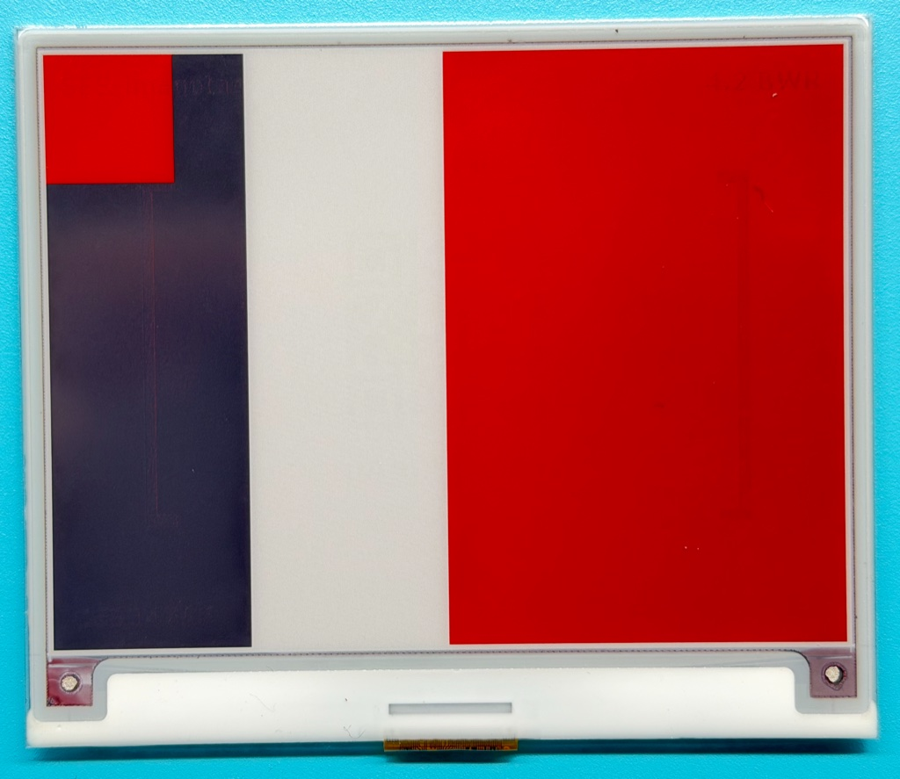

# Diagnose: Panel erkennen und prüfen

Die Diagnosefirmware in [extras/diagnose](../extras/diagnose/) beantwortet drei Fragen:

1. Welches Panel steckt am Board?
2. Antwortet es überhaupt, also stimmen Board, Schalter und Flexkabel?
3. Kann es noch ein sauberes Bild zeigen, oder ist das Exemplar beschädigt?

Sie läuft ohne die Bibliothek und spricht das Panel direkt an. Bedient wird sie über den seriellen Monitor, eine Taste pro Befehl.

## 1. Vorbereitung

Board-Schalter einstellen (Details in [boards.md](boards.md)):

| Board | Schalter | PlatformIO-Umgebung |
|---|---|---|
| Waveshare e-Paper ESP32 Driver Board | 1 = **B**, 2 = **ON** | `esp32dev` |
| Seengreat ESP32-C6 E-Paper Driver Board | S1 = **ON**, S2 = **ON** | `esp32c6` |

Flexkabel mit den Kontakten in die richtige Richtung einstecken und den Riegel schließen. Das Kabel nicht knicken, das Panel am Glas halten.

### Ohne Entwicklungsumgebung

In [extras/diagnose/bin](../extras/diagnose/bin/) liegt die Firmware fertig gebaut, je Board eine Datei:

| Board | Datei |
|---|---|
| Waveshare (ESP32) | `diagnose-waveshare-esp32.bin` |
| Seengreat (ESP32-C6) | `diagnose-seengreat-esp32c6.bin` |

Jede Datei enthält Bootloader, Partitionstabelle und Programm und wird an Adresse **`0x0`** geschrieben. Das geht direkt im Browser mit [ESPConnect](https://thelastoutpostworkshop.github.io/ESPConnect/) (Chrome, Edge oder ein anderer Chromium-Browser, kein Firefox oder Safari):

1. Board per USB anschließen, **Connect** klicken und den Port wählen.
2. Unter **Flash** → **Flash Firmware** die passende `.bin` laden, als Offset `0x0` wählen und flashen.
3. **Console** öffnen, 115200 Baud. ESPConnect setzt das Board dabei zurück und startet die Firmware.
4. Befehle als einzelne Zeichen senden, zuerst `h` für das Menü und `i` für die Chip-ID. Zeilenumbrüche ignoriert die Firmware.

Beim Seengreat (ESP32-C6) hängt USB direkt am Chip, jeder Reset meldet also auch den USB-Port kurz ab. Verliert ESPConnect dabei die Verbindung: **Disconnect**, Board kurz von USB trennen und die Konsole mit einem einfachen seriellen Terminal öffnen, z. B. [Serial Terminal](https://googlechromelabs.github.io/serial-terminal/) von Google (ebenfalls im Browser).

Startet das Board in einer Schleife neu und meldet `Detected size(4096k) smaller than the size in the binary image header`, passt die Flash-Größe im Image nicht zum Board. Die beigelegten Images sind für 4 MB gebaut, wie beide Boards sie haben.

Klappt die Verbindung nicht: **BOOT** gedrückt halten, kurz **RESET** drücken, BOOT gedrückt lassen und dabei **Connect** klicken.

Mit esptool geht es auch: `esptool write-flash 0x0 diagnose-waveshare-esp32.bin`.

### Mit PlatformIO

```sh
cd extras/diagnose
pio run -e esp32dev -t upload     # Seengreat: -e esp32c6
pio device monitor                # 115200 Baud
```

`platformio.ini` setzt `monitor_dtr = 0` und `monitor_rts = 0`. Damit startet das Board beim Öffnen des Monitors nicht neu. Ohne diese Einstellung bricht beim C6 die Verbindung ab, weil der Reset auch den USB-Port neu anmeldet.

Nach dem Start liest die Firmware einmal die Chip-ID und zeigt das Menü. `h` zeigt es erneut.

## 2. Panel erkennen (nur lesend)

Diese Befehle schreiben nichts ins Panel und sind auch bei unbekannten Panels gefahrlos.

| Taste | Funktion |
|---|---|
| `i` | Chip-ID lesen (Befehl `0x70`) |
| `o` | OTP (`B9`) und Register `72` als Hex-Dump ausgeben |
| `b` | BUSY-Leitung prüfen |
| `x` | Lesescan ausgewählter Befehle |

Mit `i` beginnen:

| Ausgabe | Panel | weiter mit |
|---|---|---|
| `71 32 5A` | 7,4" E2741ES083 (IST7x32) | `v` |
| `71 36 5A` | 5,65" E2565JS0B1 (IST7136) | `n` |
| `16 .. ..` | 5,81" E2581JS061 (Generation 06) | `o`, dann [examples/Demo581](../examples/Demo581/) |
| `00 07 ..` | 4,2" E2417JS0D1 (UC8176-kompatibel) | `P` oder `g` |
| `FF FF FF` oder `00 00 00` | keine Antwort | Abschnitt 5 |
| etwas anderes | unbekanntes Panel | `o`, `b`, `x` und die Ausgabe sichern |

Bei einem unbekannten Panel nur die lesenden Befehle senden. Die Ausgabe von `o` enthält bei Pervasive-Panels oft die Typbezeichnung im Klartext (rechte Spalte des Dumps).

## 3. Testbild

Ein Refresh dauert je nach Panel und Temperatur 20 bis 60 Sekunden. In dieser Zeit flackert das Panel mehrmals, das ist normal. Erst danach neue Befehle senden.

| Panel | Testbild | ganze Fläche | Temperatur |
|---|---|---|---|
| 7,4" | `v` | `W` weiß | – |
| 5,65" | `n` | `N` weiß, `R` rot, `K` schwarz | `T`: 25, 20, 15, 30 °C |
| 5,81" | – (Demo581) | `c` im Demo | – |
| 4,2" | `P` | `B` schwarz | `Y`: 25, 20, 15, 5, 35 °C |

Das Testbild besteht aus senkrechten Balken in Schwarz, Weiß und Rot plus einem roten Quadrat. Die genaue Anordnung steht im jeweiligen Panel-Dokument. Beim 4,2" ist der rechte Balken rot statt schwarz, das ist richtig so.



*Testbild mit `P` auf dem 4,2"-Panel. Im schwarzen und im roten Balken ist noch schwach die Schrift des alten Etiketts zu sehen (Geisterbild, siehe Abschnitt 4).*

Beim 4,2" zeichnet `g` ein Testbild mit dem GxEPD2-Ablauf ohne Temperatur. Erscheint dabei ein Bild, sind Board und Verkabelung in Ordnung. Das eignet sich auch, um ein neues Board zu prüfen.

## 4. Bild beurteilen

| Bild | Ursache | Abhilfe |
|---|---|---|
| sauber, satte Farben | Panel in Ordnung | – |
| Schatten des alten Preisschilds (z. B. QR-Code) | Geisterbild nach jahrelang gleichem Inhalt | reinigen: `C` beim 5,65", bei den anderen die Demo mit Taste `c` |
| Schwarz grau oder Rot blass | Temperatur passt nicht zum Exemplar | mit `T` bzw. `Y` eine niedrigere Temperatur wählen und Testbild wiederholen |
| blass, und mit jedem Versuch schlechter; Streifen; nur der Rahmen flackert | Übergang Flexkabel/Glas beschädigt | anderes Exemplar probieren |
| Bild ändert sich gar nicht mehr | wie oben, oder das Panel hängt nach einem Fehlbefehl | Reset (Board neu starten), dann erneut testen |

Ein Reinigungsdurchlauf schaltet die Fläche mehrmals schwarz, rot und weiß und dauert einige Minuten.

## 5. Keine Antwort

Liefert `i` nur `FF` oder `00`:

1. `b` senden. Steht dort `OFFEN (Pin nicht verbunden?)`, hat die BUSY-Leitung keinen Kontakt. Meist sitzt das Flexkabel nicht richtig oder ist verkehrt herum eingesteckt.
2. Schalter prüfen. Beim Seengreat muss S1 auf ON stehen, sonst läuft das Board im 3-Draht-Modus und das Panel antwortet nicht.
3. Richtige Umgebung geflasht? `esp32dev` und `esp32c6` haben verschiedene Pins.
4. Mit einem bekannt guten Panel gegenprüfen, am einfachsten mit dem 4,2" und `g`.

## Befehle aus der Fehlersuche

Die Tasten `1 2 3 c s w u p k f r q z m M O` stammen aus der Entwicklung der Treiber. Sie bleiben in der Firmware, damit sich die Versuche nachvollziehen lassen, helfen aber bei keinem der drei Panels. `q` und `z` senden auch unbekannte Befehle, `z` sogar alle 256. Danach hängt das Panel oft, bis es zurückgesetzt wird. Bei einem unbekannten Panel diese beiden erst verwenden, wenn die lesenden Befehle ausgewertet und gesichert sind.

## Weitere Details

- [panel-7.4-zoll.md](panel-7.4-zoll.md#diagnosefirmware)
- [panel-5.65-zoll.md](panel-5.65-zoll.md#diagnosefirmware)
- [panel-4.2-zoll.md](panel-4.2-zoll.md#diagnosefirmware)
- [boards.md](boards.md): Pins, Schalter, Flexkabel-Belegung
