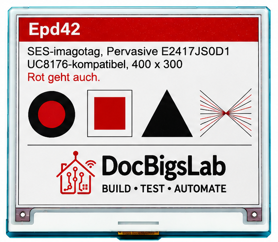

# SES-imagotag 4,2" BWR

Stand: 20.11.2026. Das Panel läuft seit Anfang November 2026 im Projekt [esp32c6-epaper-weather-calendar](https://github.com/DocBigs-Lab/esp32c6-epaper-weather-calendar) auf dem Seengreat ESP32-C6 E-Paper Driver Board.



Das Foto entstand mit `Epd42` bei 15 °C am Seengreat ESP32-C6.

## Kurzfassung

Anders als das 7,4"- und das 5,65"-Panel versteht dieses Panel den Befehlssatz des **UC8176**. Die Klasse `Epd42` steuert es mit dem Pervasive-Ablauf für kleine Panels an und übergibt dabei die Temperatur. Das ist wichtig: Die Temperatur wählt die Ansteuerkurve, und nicht jedes Exemplar wird bei 25 °C satt schwarz. Mit GxEPD2 (`GxEPD2_420c`) läuft das Panel auch, dort lässt sich die Temperatur aber nicht setzen.

## Hardware

| Teil | Angabe |
|---|---|
| Preisschild | unbekannt (SES-imagotag) |
| Panel | 4,2" (4,17"), Schwarz/Weiß/Rot, 400 × 300, aktive Fläche 84,8 × 63,6 mm |
| Etikett auf dem Panel | `SE2417JS0D1`, `SPP1661`, `A00C6803YC`, `24116-00546` → Pervasive **E2417JS0D1** |
| Flexkabel | 24 Pin, Aufdruck `A1360093-00 01`, Datumscode `2217` (KW 17/2022) |
| Controller | UC8176-kompatibel. Antwort auf `0x70` (beim UC8176: Revision): `00 07 FF` |
| Refresh | ca. 23 s bei 25 °C, ca. 22 s bei 15 °C, ca. 55 s bei 5 °C |
| Getestet an | Seengreat ESP32-C6 E-Paper Driver Board (`Epd42` mit Demo, GxEPD2 im Wetter-Kalender), Waveshare ESP32 Driver Board (`Epd42` mit Demo) |

Flexkabel-Belegung, Schalter und Pins: [boards.md](boards.md).

### Etikett lesen

Nach dem Pervasive-Schema (siehe [panel-5.65-zoll.md](panel-5.65-zoll.md#etikett-lesen)):

| Stellen | Inhalt | Wert |
|---|---|---|
| 1 | Hersteller-/Lieferantencode | `S` |
| 2–11 | Typnummer | `E2417JS0D1` |
| 12–17 | Charge der Displayfolie | `SPP166` |
| 18 | Code der Ansteuerkurve | `1` |
| 19–21 | reserviert | `A00` |
| 22–24 | Herstelldatum (kodiert) | `C68` |
| 25–28 | Seriennummer | `03YC` |

Die Zeile `24116-…` steht genauso auf dem 5,65"-Panel (`24116-00415`). Sie gehört nicht zum Pervasive-Schema, vermutlich ist es eine Losnummer von SES.

## Ablauf eines Bildaufbaus

Umgesetzt in `Epd42::display()` in [src/Epd42.cpp](../src/Epd42.cpp).

1. **Reset:** RST high, 5 ms, low, 10 ms, high, 10 ms. Warten bis BUSY high.
2. **Soft-Reset:** `00 0E`, warten bis BUSY high.
3. **Temperatur:** `E5` ← Temperatur in Grad C (25 °C = `19`), dann `E0 02`.
4. **Panel-Einstellung:** `00 CF 8D`.
5. **Ebene Schwarz:** `10` + 15 000 Byte (1 = schwarz).
6. **Ebene Rot:** `13` + 15 000 Byte (1 = rot). Sind in beiden Ebenen Bits gesetzt, gewinnt Rot. Der Treiber setzt deshalb immer nur eins.
7. **Power ON:** `04 00`, warten bis BUSY high (ca. 65 ms).
8. **Refresh:** `12`, warten bis BUSY high.
9. **Power OFF:** `02 00`.

Bildformat: 300 Zeilen zu je 50 Byte, MSB = erstes Pixel. Mit dem Flexkabel unten liegt (0,0) oben links, es braucht keine Umrechnung.

## Temperatur und Schwarz

Zwei Exemplare im Vergleich, am selben Seengreat-Board:

| Temperatur | Refresh | Exemplar aus dem Wetter-Kalender | zweites Exemplar |
|---|---|---|---|
| ohne (GxEPD2) | ca. 23 s | satt schwarz | Schwarz grau |
| 25 °C | 22,6 s | | Schwarz grau, Rot sauber |
| 15 °C | 22,0 s | | Schwarz dunkel, leicht bräunlich |
| 5 °C | 54,6 s | | bestes Ergebnis |

Die Temperatur verlängert die Kurve also nicht einfach: Bei 15 °C ist der Refresh sogar etwas kürzer, der Chip nimmt eine andere Kurve mit anderen Spannungen und Phasen. Erst unter 15 °C wird sie deutlich länger. Mit 3 Ω statt 0,47 Ω als Messwiderstand (Seengreat S2 = OFF) wurde Rot dunkelbraun, Schwarz blieb grau, S2 bleibt also auf ON.

Empfehlung: Mit 25 °C anfangen. Bleibt Schwarz grau, `setTemperature()` schrittweise senken. Die Demo schaltet dafür mit `t` zwischen 25, 15 und 5 °C um.

```cpp
#include <Epd42.h>

Epd42 epd(epdPinsSeengreatC6());   // Waveshare: Epd42 epd;

void setup() {
    epd.begin();
    epd.setTemperature(5);           // fuer satteres Schwarz, Refresh dann ca. 55 s
    epd.fillScreen(EPD_WHITE);
    epd.setTextColor(EPD_RED);
    epd.setCursor(20, 40);
    epd.print("Hallo");
    epd.display();
}

void loop() {}
```

## Alternative: GxEPD2

Das Panel läuft auch mit dem GxEPD2-Treiber `GxEPD2_420c`, so im Wetter-Kalender. GxEPD2 übergibt keine Temperatur, das Ergebnis hängt also vom Exemplar ab. Außerdem wartet GxEPD2 beim Refresh nur 20 s, das Panel braucht etwa 23 s:

```cpp
// Das Panel braucht ~23 s fuer den Refresh, GxEPD2 wartet nur 20 s ("Busy Timeout!").
struct EPD_SES42 : GxEPD2_420c {
    EPD_SES42(int16_t cs, int16_t dc, int16_t rst, int16_t busy) : GxEPD2_420c(cs, dc, rst, busy) {
        _busy_timeout = 40000000;   // us
    }
};
GxEPD2_3C<EPD_SES42, EPD_SES42::HEIGHT> display(EPD_SES42(EPD_CS, EPD_DC, EPD_RST, EPD_BUSY));
```

Die vollständige Anwendung mit Wetter, Terminen, Deep Sleep und Akkubetrieb steht im Wetter-Kalender.

## Diagnosefirmware

Allgemeiner Ablauf: [diagnose.md](diagnose.md).

In [extras/diagnose](../extras/diagnose/) erkennt `i` das Panel an der Antwort `00 07`. `P` und `B` zeichnen Testbild bzw. schwarze Fläche mit dem Pervasive-Ablauf für kleine Panels, `Y` schaltet dafür die Temperatur um (25, 20, 15, 5, 35 °C). Im Testbild ist der rechte Balken rot statt schwarz, weil dort beide Ebenen gesetzt sind. `g` zeichnet ein Testbild mit UC8176-Befehlen (400 × 300). Damit lässt sich auch prüfen, ob ein Board grundsätzlich funktioniert.

## Quellen

- [DigiKey: Pervasive E2417JS0D1](https://www.digikey.co.uk/en/products/detail/pervasive-displays/E2417JS0D1/13572404): 4,2", 400 × 300, Schwarz/Weiß/Rot
- [Pervasive E2417JS0D1, Datenblatt 1P233-00 (Mouser)](https://www.mouser.com/datasheet/2/1089/1P233_00_02_E2417JS0D1_20211108-3132823.pdf)
- [esp32c6-epaper-weather-calendar](https://github.com/DocBigs-Lab/esp32c6-epaper-weather-calendar): Anwendung, Hardware-Doku und Strommessungen
