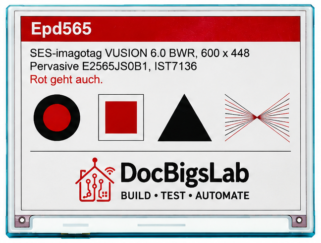

# SES-imagotag 5,65" BWR (VUSION 6.0)

Stand: 20.11.2026. Das Panel zeigt Schwarz, Weiß und Rot sauber, am Seengreat ESP32-C6 und am Waveshare ESP32 Driver Board.

## Kurzfassung

Das Panel stammt aus dem Preisschild **SES-imagotag VUSION 6.0 BWR GU140** (Modell `EDG3-0600-A`). Es ist ein Pervasive-Displays-Panel **E2565JS0B1** mit Treiberchip **IST7136**. Anders als beim 7,4"-Panel stehen alle Parameter im OTP des Panels: Bildfenster, Timing, Spannungen und die Tabelle für den Hochlauf der Hochspannung. Der Treiber `Epd565` liest das OTP beim Start und nutzt nur diese Werte.

## Hardware

| Teil | Angabe |
|---|---|
| Preisschild | SES-imagotag VUSION 6.0 BWR GU140, Modell `EDG3-0600-A` |
| Panel | 5,65", Schwarz/Weiß/Rot, 600 × 448 |
| Etikett auf dem Panel | `SE2565JS0B1`, `SPP21X1`, `U00DCC01N5` → Pervasive **E2565JS0B1** |
| Flexkabel | 24 Pin, Aufdruck `A1360116-00 01`, Datumscode `2345` (KW 45/2023) |
| Treiberchip | IST7136 (Antwort auf `0x70`: `71 36 5A`) |
| Getestet an | Seengreat ESP32-C6 E-Paper Driver Board (S1 = ON, S2 = ON) und Waveshare e-Paper ESP32 Driver Board (Schalter 1 = B, 2 = ON), jeweils mit Bibliothek und Demo |

Flexkabel-Belegung, Schalter und Pins beider Boards: [boards.md](boards.md). Die Belegung ist dieselbe wie beim 7,4"-Panel.

### Etikett lesen

Pervasive beschreibt das 28-stellige Etikett im Datenblatt des E2741JS0B2:

| Stellen | Inhalt | Wert |
|---|---|---|
| 1 | Hersteller-/Lieferantencode | `S` |
| 2–11 | Typnummer | `E2565JS0B1` |
| 12–17 | Charge der Displayfolie | `SPP21X` |
| 18 | Code der Ansteuerkurve | `1` |
| 19–21 | reserviert | `U00` |
| 22–24 | Herstelldatum | `DCC` |
| 25–28 | Seriennummer | `01N5` |

## OTP

Befehl `B9` liest das OTP. Die erste Antwort ist ein Leerbyte, danach folgen 128 Byte ab Adresse 0. Die Belegung laut Pervasive-Doku „Medium BW/BWR“:

| Adresse | Register | Wert |
|---|---|---|
| `0x0B` | TCON | `25` |
| `0x0C`–`0x0F` | DRFW (Refresh-Fenster) | `00 37 00 96` |
| `0x10` | DCTL | `09` |
| `0x11` | VCOM | `00` |
| `0x12`–`0x14` | RAM_RW (Schreibstart) | `00 00 00` |
| `0x15`–`0x1A` | DUW (Schreibfenster) | `00 37 00 00 57 02` |
| `0x1B` | STV_DIR | `01` |
| `0x1C` | MS_SYNC | `00` |
| `0x1D` | BVSS | `00` |
| `0x28`–`0x47` | Hochlauf der Hochspannung, 4 Stufen à 8 Byte | siehe unten |
| `0x68`–`0x75` | Typ und Charge als Text | `S12565JS0B121X` |

DUW beschreibt 56 Byte (448 Pixel) pro Zeile und 600 Zeilen. Daraus ergibt sich die Auflösung.

### Hochlauf der Hochspannung

Jede Stufe hat 8 Byte. Ist Bit 7 im ersten Byte gesetzt (Format 1):

| Byte | Bedeutung |
|---|---|
| 0 | Bit 7 = Format 1, Bit 0–6 = Wiederholungen |
| 1, 2 | Startwerte PHL, PHH für Befehl `51` |
| 3, 4 | Änderung von PHL, PHH pro Wiederholung (Zweierkomplement) |
| 5, 6 | Wert für Befehl `09` vor und nach `51` |
| 7 | Bit 7 = Einheit ms (sonst 10 µs), Bit 0–6 = Wartezeit |

Bei unserem Panel:

| Stufe | Bytes | Ablauf |
|---|---|---|
| 1 | `84 50 00 00 01 1F 9F 81` | 4 ×, PHL `50`, PHH 1 bis 4 |
| 2 | `8A 0A 00 00 01 1F 9F 81` | 10 ×, PHL `0A`, PHH 1 bis 10 |
| 3 | `89 0A 02 00 01 7F FF 83` | 9 ×, PHL `0A`, PHH 3 bis 11 |
| 4 | `87 0A 0B FF 00 7F FF 81` | 7 ×, PHL 9 bis 3, PHH 11 |

## Ablauf eines Bildaufbaus

Umgesetzt in `Epd565::display()` in [src/Epd565.cpp](../src/Epd565.cpp).

1. **Reset:** 200 ms warten, RST high, 20 ms, RST low, 200 ms, RST high, 50 ms, CS high, 5 ms.
2. **DCTL:** `01` ← OTP `0x10` (1 Byte).
3. **Fenster:** `13` ← DUW, `90` ← DRFW, `12` ← RAM_RW.
4. **Ebene Schwarz:** `10` + 33 600 Byte (1 = schwarz).
5. **Ebene Rot:** `12` ← RAM_RW, dann `11` + 33 600 Byte (1 = rot).
6. **Einschalten:** `05 7D`, 200 ms, `05 00`, 10 ms, `D8` ← MS_SYNC, `D6` ← BVSS, dann `A7 10`/`A7 00` mit je 100 ms.
7. **Temperatur:** `44 00`, `45 80`, `A7`-Puls, `44 06`, `45` ← Temperaturcode, `A7`-Puls. Code = Temperatur × 2 + `0x50`, also `0x82` bei 25 °C.
8. **TCON, STV_DIR, VCOM:** `60`, `61`, `02` aus dem OTP.
9. **Hochspannung:** 4 Stufen laut OTP-Tabelle.
10. **Refresh:** warten bis BUSY high, `15 3C`, warten bis BUSY wieder high (ca. 31 s bei 25 °C, ca. 42 s bei 15 °C).
11. **Abschalten:** `09 7F`, `05 3D`, `09 7E`, 15 ms, `09 00`, danach DC, CS und RST low.

Der Oszillatorbefehl `03` wird **nicht** gesendet. DCTL geht nur einmal raus.

### Bildformat und Ausrichtung

600 Zeilen zu je 56 Byte, MSB = erstes Pixel. Mit dem Flexkabel unten ist Zeile 0 links und Pixel 0 einer Zeile unten. Der Treiber rechnet das in ein Querformat 600 × 448 mit (0,0) oben links um.

## Was nicht funktioniert hat

| Versuch | Ergebnis |
|---|---|
| Ablauf und Fenster des 7,4"-Panels (`EPD_Driver_GU_mid`) | kein Bild |
| Fensterwerte aus dem OTP, sonst 7,4"-Ablauf mit `03 ← 00 01` und `C2` | Bild an der richtigen Stelle, aber nur grau, kein Rot |
| Temperaturcode `T + 0x28` (aus `Pervasive_Wide_Large`) | `0x41` bedeutet hier −7,5 °C, Refresh 58 s, kein Rot |
| Oszillator `03` mit `00 01`, `00 11`, `00 21` | Refresh-Zeit unverändert, Bild schlechter |

Ein erstes Exemplar desselben Typs zeigte auch mit dem richtigen Ablauf nur blasse Farben und wurde mit jedem Test schlechter: erst blass, dann Streifen, am Ende flackerte nur noch der Rahmen. Das zweite Exemplar lief sofort sauber. Vermutlich war beim ersten die Verbindung zwischen Flexkabel und Glas beschädigt, etwa beim Ausbau aus dem Preisschild. Beim Ausbau das Flexkabel nicht knicken und das Panel am Glas halten.

## Diagnosefirmware

Allgemeiner Ablauf: [diagnose.md](diagnose.md).

In `extras/diagnose` (Umgebungen `esp32dev` und `esp32c6`):

| Taste | Funktion |
|---|---|
| `i` | Chip-ID lesen (`71 36 5A`) |
| `o` | OTP (`B9`) und `72` als Hex ausgeben, nur lesend |
| `n` | Testbild mit allen Werten aus dem OTP: Balken schwarz, rot, weiß, schwarz (von links, Flexkabel unten), rotes Quadrat unten rechts |
| `N`, `R`, `K` | ganze Fläche weiß, rot, schwarz |
| `C` | 3 Reinigungsrunden schwarz, rot, weiß |
| `T` | Temperatur umschalten (25, 20, 15, 30 °C) |

`m`/`M` (Ablauf des 7,4"-Panels) und `O` (Oszillator) stammen aus der Fehlersuche und helfen bei diesem Panel nicht.

## Quellen

- [Pervasive Knowledge Base, Medium BW/BWR, Update procedure](https://docs.pervasivedisplays.com/knowledge/Archives/Hardware/Screens/medium-epds/global-update.html): OTP-Adressen, Bildgröße 33 600 Byte, Aufbau der Hochlauf-Tabelle
- [PervasiveDisplays/EPD_Driver_GU_large](https://github.com/PervasiveDisplays/EPD_Driver_GU_large): Ablauf für den IST7136 (BSD-Lizenz)
- [PervasiveDisplays/PDLS_EXT3_Basic_Global](https://github.com/PervasiveDisplays/PDLS_EXT3_Basic_Global): Referenz für „Medium screens with C or J film“, Treiber B (CC BY-SA 4.0, nur zum Abgleich genutzt)
- [shanislav/GxEPD2_PervasiveDisplays](https://github.com/shanislav/GxEPD2_PervasiveDisplays): Treiber für ein verwandtes SES-Panel (VUSION 5.9, SE2581JS0G1) mit demselben Ablauf
- [Pervasive E2741JS0B2, Datenblatt (LCSC)](https://lcsc.com/datasheet/lcsc_datasheet_2410161329_Pervasive-Displays-E2741JS0B2_C17365569.pdf): Pinbelegung, Etikett-Schema
