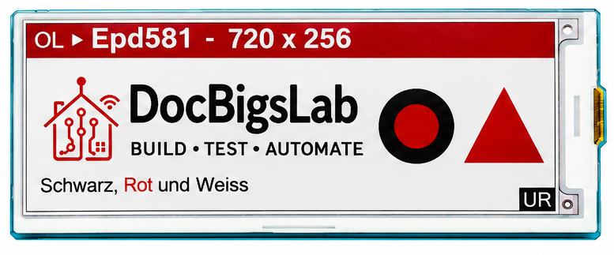

# SES-imagotag 5,81" BWR (VUSION 5.9)

Stand: 25.11.2026. Das Panel zeigt Schwarz, Weiß und Rot sauber, am Waveshare ESP32 Driver Board und am Seengreat ESP32-C6.



## Kurzfassung

Das Panel stammt aus dem Preisschild **SES-imagotag VUSION 5.9 BWR GU110** (Modell `EDG3-0590-A`). Es ist ein Pervasive-Displays-Panel **E2581JS061** mit 720 × 256 Pixeln. Die Endziffern `06` stehen für eine neuere Treiber-Generation als beim 7,4" und 5,65" (`0B`). Wie beim 5,65" stehen alle Parameter im OTP des Panels, der Ablauf weicht aber in einigen Punkten ab (DCTL, VCOM_CTRL, Temperaturcode, Wartezeiten). Der Treiber `Epd581` liest das OTP beim Start und nutzt nur diese Werte.

## Hardware

| Teil | Angabe |
|---|---|
| Preisschild | SES-imagotag VUSION 5.9 BWR GU110, Modell `EDG3-0590-A` |
| Panel | 5,81" (SES: 5,9"), Schwarz/Weiß/Rot, 720 × 256 |
| Etikett auf dem Panel | `SE2581JS061`, `SPP2FK1`, `U00E1U0EEC`, `24116-00808` → Pervasive **E2581JS061** |
| Flexkabel | 24 Pin, Aufdruck `A1360117-00 02`, weitere Codes `9U-0`, `2401` |
| Treiber | Generation 06, Antwort auf `0x70`: `16 87 05`, erstes OTP-Byte `16` |
| Getestet an | Waveshare e-Paper ESP32 Driver Board (Schalter 1 = B, 2 = ON) und Seengreat ESP32-C6 E-Paper Driver Board (S1 = ON, S2 = ON), jeweils mit Bibliothek und Demo |

Flexkabel-Belegung, Schalter und Pins: [boards.md](boards.md). Die Belegung ist dieselbe wie bei den anderen Panels. Das Flexkabel sitzt an der rechten Schmalseite.

### Etikett lesen

Schema aus dem Datenblatt des E2741JS0B2 (siehe [panel-5.65-zoll.md](panel-5.65-zoll.md#etikett-lesen)):

| Stellen | Inhalt | Wert |
|---|---|---|
| 1 | Hersteller-/Lieferantencode | `S` |
| 2–11 | Typnummer | `E2581JS061` |
| 12–17 | Charge der Displayfolie | `SPP2FK` |
| 18 | Code der Ansteuerkurve | `1` |
| 19–21 | reserviert | `U00` |
| 22–24 | Herstelldatum | `E1U` |
| 25–28 | Seriennummer | `0EEC` |

## OTP

Befehl `B9` liest das OTP, wie beim 5,65": ein Leerbyte, danach 128 Byte ab Adresse 0.

```
00: 16 95 07 01 53 50 50 32 46 4B 01 25 00 1F 14 C7
10: 00 00 1F 50 04 1F 00 50 00 1F 03 02 00 02 FF 03
20: FF FF FF FF FF FF FF FF 84 50 00 00 01 1F 9F 81
30: 8A 0A 00 00 01 1F 9F 81 8C 0A 02 00 01 7F FF 83
40: 86 0A 0E FF 00 7F FF 81 FF FF FF FF FF FF FF FF
50: FF FF FF FF FF FF FF FF FF FF FF FF FF FF FF FF
60: FF FF FF FF FF FF FF FF 53 31 32 35 38 31 4A 53
70: 30 36 31 32 46 4B FF FF FF FF FF FF FF FF FF FF
```

| Adresse | Register | Wert |
|---|---|---|
| `0x00` | Kennung der Generation | `16` |
| `0x0B` | TCON | `25` |
| `0x0C`–`0x0F` | DRFW (Refresh-Fenster) | `00 1F 14 C7` |
| `0x10` | DCTL | `00` |
| `0x11` | VCOM | `00` |
| `0x12`–`0x14` | RAM_RW (Schreibstart) | `1F 50 04` |
| `0x15`–`0x1A` | DUW (Schreibfenster) | `1F 00 50 00 1F 03` |
| `0x1B` | STV_DIR | `02` |
| `0x1C` | MS_SYNC | `00` |
| `0x1D` | BVSS | `02` |
| `0x1F` | VCOM_CTRL | `03` |
| `0x28`–`0x47` | Hochlauf der Hochspannung, 4 Stufen à 8 Byte | siehe unten |
| `0x68`–`0x75` | Typ und Charge als Text | `S12581JS0612FK` |

DUW beschreibt 32 Byte (256 Pixel) pro Zeile, **rückwärts** von Byte 31 bis 0, und die Zeilen 80 bis 799, also 720 Zeilen. Der Chip ist für 800 Zeilen ausgelegt, das Panel nutzt davon die letzten 720.

### Hochlauf der Hochspannung

Aufbau der Tabelle wie beim 5,65" ([panel-5.65-zoll.md](panel-5.65-zoll.md#hochlauf-der-hochspannung)). Generation 06 nutzt nur Format 1, die Wartezeit ist immer in ms.

| Stufe | Bytes | Ablauf |
|---|---|---|
| 1 | `84 50 00 00 01 1F 9F 81` | 4 ×, PHL `50`, PHH 1 bis 4, je 1 ms |
| 2 | `8A 0A 00 00 01 1F 9F 81` | 10 ×, PHL `0A`, PHH 1 bis 10, je 1 ms |
| 3 | `8C 0A 02 00 01 7F FF 83` | 12 ×, PHL `0A`, PHH 3 bis 14, je 3 ms |
| 4 | `86 0A 0E FF 00 7F FF 81` | 6 ×, PHL 9 bis 4, PHH 14, je 1 ms |

## Ablauf eines Bildaufbaus

Umgesetzt in `Epd581::display()` in [src/Epd581.cpp](../src/Epd581.cpp). Unterschiede zum 5,65" sind **fett**.

1. **Reset:** **5 ms** warten, RST high, **2 ms**, RST low, **4 ms**, RST high, **20 ms**, CS high, 5 ms.
2. **DCTL:** `01` ← OTP `0x10`, **gefolgt von `00` (2 Byte)**.
3. **Fenster:** `13` ← DUW, `90` ← DRFW, `12` ← RAM_RW.
4. **Ebene Schwarz:** `10` + 23 040 Byte (1 = schwarz).
5. **Ebene Rot:** `12` ← RAM_RW, dann `11` + 23 040 Byte (1 = rot).
6. **Einschalten:** `05 7D`, **50 ms**, `05 00`, **1 ms**, `D8` ← MS_SYNC, `D6` ← BVSS, dann `A7 10`/`A7 00` mit **2 ms und 10 ms**.
7. **Temperatur:** `44 00`, `45 80`, `A7`-Puls, `44 06`, `45` ← Temperaturcode, `A7`-Puls. **Code = Temperatur + `0x28`**, also `0x41` bei 25 °C, gültig von `0x19` (−15 °C) bis `0x64` (60 °C).
8. **TCON, STV_DIR, VCOM, VCOM_CTRL:** `60`, `61`, `02` und **`03`** aus dem OTP.
9. **Hochspannung:** 4 Stufen laut OTP-Tabelle.
10. **Refresh:** warten bis BUSY high, `15 3C`, warten bis BUSY wieder high (ca. 51,5 s bei 25 °C).
11. **Abschalten:** `09 7F`, `05 3D`, `09 7E`, **60 ms**, `09 00`, danach DC, CS und RST low.

### Bildformat und Ausrichtung

720 Zeilen zu je 32 Byte, MSB = erstes Pixel. Der Treiber rechnet das in ein Querformat 720 × 256 mit (0,0) oben links um, wenn das Flexkabel rechts liegt: Zeile = 719 − x, Pixel in der Zeile = y.

## Was nicht funktioniert hat

| Versuch | Ergebnis |
|---|---|
| Ablauf des 7,4"-Panels (`EPD_Driver_GU_mid`, Zweig für 5,81") | Refresh läuft ca. 35 s, BUSY verhält sich normal, aber nur der Rahmen flackert, die Bildfläche bleibt unverändert |
| dasselbe mit dem Fenster des 7,4" (800 Zeilen × 60 Byte) | ebenfalls nur der Rahmen |

Der alte Herstellercode ist für die Generation `0B` (z. B. E2581CS0B1) geschrieben. An der Chip-ID (`16 ..` statt `71 32 5A`) lässt sich der Unterschied vorab erkennen.

## Diagnosefirmware

Allgemeiner Ablauf: [diagnose.md](diagnose.md). Die Diagnosefirmware erkennt das Panel an der Chip-ID (`i`) und gibt das OTP aus (`o`). Ein eigenes Testbild hat sie für dieses Panel nicht, dafür das Demo in [examples/Demo581](../examples/Demo581/) nehmen. Es gibt das OTP beim Start ebenfalls aus und bricht ab, wenn es nicht passt.

## Quellen

- [Pervasive Knowledge Base, Medium BW/BWR, Update procedure](https://docs.pervasivedisplays.com/knowledge/Archives/Hardware/Screens/medium-epds/global-update.html): OTP-Adressen, Aufbau der Hochlauf-Tabelle
- [PervasiveDisplays/Pervasive_Wide_Medium](https://github.com/PervasiveDisplays/Pervasive_Wide_Medium): Ablauf der Treiber-Generation 06 für 5,81" (CC BY-SA 4.0, nur zum Abgleich genutzt)
- [PervasiveDisplays/EPD_Driver_GU_mid](https://github.com/PervasiveDisplays/EPD_Driver_GU_mid): Ablauf der Generation `0B`, hier ohne Erfolg
- [Pervasive Displays, 5,81"-Panels](https://www.pervasivedisplays.com/products/5-81-e-ink-displays/): Auflösung 720 × 256, aktive Fläche 138,96 × 49,41 mm
